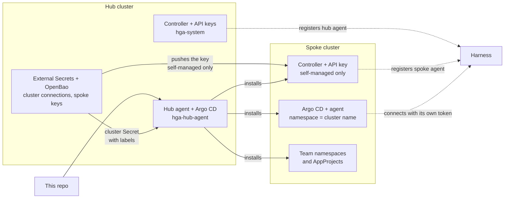

# Harness GitOps Agents reference architecture

A reference architecture for running Harness GitOps Agents on many clusters
with the official HGA controller (`harness/gitops-agent-bootstrap-controller`),
modelled on EKS Fleet Management.

One account-level agent on a **hub** cluster deploys an agent onto every
**spoke** cluster, from files in this repo. Adding a cluster is one member
file. Adding a team is one team file.

**[docs/architecture.md](docs/architecture.md) is the full description**: who
holds what, every step from an empty machine, what has run and what has not,
and the open questions. This README is the short version.

## Status

Previous workshop runs used one local k3d hub and one spoke, `spoke-test`.
This branch's grouped bootstrap has offline checks, with live validation pending.
Two models exist for a spoke's agent:

| Model | Member file | Where the controller and the Harness API key are | State |
|---|---|---|---|
| Self-managed | `agentModel: ""` | On the hub and on every spoke. Each spoke has its own key, which the hub pushes to it. | Running on `spoke-test` |
| Hub-managed | `agentModel: hub` | On the hub only. External Secrets pushes the agent's own token to the spoke. | No fleet member uses it. It ran on one spoke that has been removed. |

Hub-managed is the intended one: Harness API access belongs to the hub, and
a spoke only does GitOps.



## Layout

```
bootstrap/          group installer ApplicationSet, applied by the hub's root Application
groups/             addons, fleet registration, and spoke agent group values
fleet-members/      one file per spoke: tenant, stage, gitopsAgent, agentModel,
                    harnessSecretName
decommissioned/     member files of removed spokes; nothing reads it
tenants/<tenant>/gitops-agents/
  defaults/         values for every spoke of the tenant
  defaults/teams/   one file per team, for every spoke of the tenant
  <stage>/          values, and optionally teams, for one stage
charts/             application-sets, the official controller chart, gitops-agent
                    (wraps the official gitops-helm), cluster-registration,
                    agent-registration, teams-bootstrap
hub/                values for the Day 0 pipeline
addons/hub/         values for the hub's add-ons (OpenBao)
workshop/1-harness-setup/   OpenTofu for every Harness entity, and the pipeline
workshop/2-clusters/        OpenTofu and k3d.sh for the local test clusters
docs/               the architecture document, an older page on people and
                    ownership, diagrams
```

Harness resolves its expressions in the pipeline definitions and values under
`hub/`. Keep Harness expressions out of the files Argo CD renders.

The `fleet` group uses `cluster-registration` to set up the Argo CD connection
to each spoke on the hub. The `agents` group uses `agent-registration` to
render the spoke's `HarnessGitopsAgent` and related resources, and `gitops-agent`
to run Argo CD and the agent on the spoke.

## From zero to a hub

For an offline check, run `python3 tests/check-appsets.py` from the repository
root with Helm and PyYAML installed.

1. Create or update the Harness entities with `tofu apply` in
   [workshop/1-harness-setup/](workshop/1-harness-setup/README.md). It needs a
   Harness account, a personal access token and a GitHub App installed on
   this repo.
2. Have a cluster for the hub with a Harness delegate in it. For a local k3d
   hub, the `hub` workspace of
   [workshop/2-clusters/](workshop/2-clusters/README.md) creates both.
3. For a grouped test, push `workshop-appsets-groups` to the GitHub repo used
   by the connector. Apply the Harness setup in step 1 from that checkout.
4. Run pipeline `hga_hub_bootstrap` with input set `hga_hub_bootstrap_test`.
   The set fills `git_ref` with `main`. For a grouped test, select the input set,
   then change `git_ref` to `workshop-appsets-groups` in the Run Pipeline dialog.
   Use an isolated test hub and check that the selected infrastructure's
   delegate is connected there. The pipeline installs the controller into
   `hga-system`, then the hub agent and Argo CD into `hga-hub-agent`.
5. On `workshop-appsets-groups`, the root Application applies
   `bootstrap/groups.yaml`. This ApplicationSet creates `hub-cluster-addons`,
   `hub-cluster-fleet` and `hub-cluster-agents`.
   Each installs `charts/application-sets` with the corresponding `groups/`
   values, producing the ApplicationSets for the hub's add-ons, fleet member
   registration, and agent deployment.

Check:

```bash
kubectl -n hga-hub-agent get applications,applicationsets
kubectl -n hga-hub-agent get application cluster-application-sets \
  -o jsonpath='{.spec.source.targetRevision}{"\n"}'
```

Check both Helm deploy logs for the selected branch. The root Application,
group Applications and their Git-backed children should all reference it.
Check that the group Applications sync, the hub add-on Applications are Synced
and Healthy, and the hub agent is CONNECTED and HEALTHY in Harness. Then add
the test spoke's OpenBao entries and verify its cluster Secret, Applications,
agent and Ready project mappings.

For a fresh test, use an empty hub with a hub agent identifier available in the
test Harness account. Then rerun the same branch and input set on that hub.
Verify that the existing hub registration, group and workload Applications,
and project mappings stay healthy without duplicates. Use the empty hub for
the first grouped test because pruning is disabled. On an existing hub, the
old `hub-cluster-spokes` Application can remain and keep tracking the same
spoke ApplicationSets that `hub-cluster-agents` would manage.

## Add a cluster with an agent

Self-managed:

1. Write two entries into the store: the cluster's connection at
   `clusters/<cluster>` (keys `server`, `caData`, `token`) and the spoke's own
   Harness API key at `harness-api-keys/<cluster>` (property `api_key`). For a
   local k3d spoke, [workshop/2-clusters/](workshop/2-clusters/README.md)
   creates the cluster and the key and writes both entries.
2. Commit `fleet-members/<cluster>.yaml` on the branch selected by `git_ref`:

   ```yaml
   tenant: bu1        # the Harness org
   stage: test        # which values and teams it gets
   gitopsAgent: true  # install an agent
   agentModel: ""     # "" = self-managed, hub = hub-managed
   harnessSecretName: harness-api-keys/<cluster>   # the key the hub pushes
   ```

External Secrets builds the Argo CD cluster Secret from the store and the
file. Its labels make three Applications for the spoke: `<cluster>-controller`,
`<cluster>-runtime` and `<cluster>-teams`. External Secrets pushes the key to
the spoke, the spoke's controller registers the agent under the tenant's org,
and the agent connects. Every Application of a cluster carries the label
`cluster`, so the filter `cluster:<name>` in the Harness GitOps list shows
them together.

Without `harnessSecretName`, create Secret `harness-api-key-secret` in
namespace `hga-system` on the spoke by hand.

With `agentModel: hub`, leave `harnessSecretName` out: no key and no
controller go to the spoke. See the architecture document for what that model
installs where, and for what is not proven.

## Add a team

1. Create the team's Harness project in the tenant's org (OpenTofu,
   `workshop/1-harness-setup/business-units.tf`).
2. Commit `tenants/<tenant>/gitops-agents/defaults/teams/<team>/values.yaml`
   with the project id, the source repos, the namespaces and the destinations.
   `tenants/bu1/gitops-agents/defaults/teams/team-a/values.yaml` is an example.

Every spoke of that tenant gets the team's namespaces, its AppProject and its
mapping to the Harness project. A team file under `<stage>/teams/` reaches
only the spokes of that stage. Namespaces must start with `<team>-`.

## Things that bite

- A spoke's name is its member file name. It becomes the namespace, the agent
  name and the Harness identifier, and can never change. Neither can its
  tenant.
- Nothing is deleted automatically. Removing a member file or a team file
  leaves everything in place. Offboarding is manual.
- Move a removed spoke's member file to `decommissioned/`. A subfolder of
  `fleet-members/` is still read.
- Never delete the ExternalSecret of a live spoke: it owns the cluster Secret,
  and with it the hub's access to the spoke.
- No old `<cluster>-agent-token` Secret may exist where a controller is about
  to register an agent. The controller never overwrites one.
- OpenBao runs in dev mode and is empty after every restart. Write the cluster
  connections and the keys again; `workshop/2-clusters/README.md` has the two
  commands.
- An ApplicationSet that matches nothing still reports success. Check
  `kubectl get applications`.
- Harness expressions in comments under `hub/` are evaluated. Never write
  expression syntax in a comment there.
- The hub holds cluster-admin on every spoke.
- The workshop uses one `git_ref` for its own charts and values, defaulting to
  `main` for every stage. The upstream charts are pinned to ESO `2.15.0` and
  OpenBao `0.30.7`.

## Not included yet

- Hub-managed on a current fleet member, and moving a spoke to it.
- A persistent secret store.
- Staged upgrades across stages.
- Offboarding a team, a spoke or a tenant.
- Team repositories feeding Applications, and Harness roles for team users.
- Anything outside local k3d clusters.
