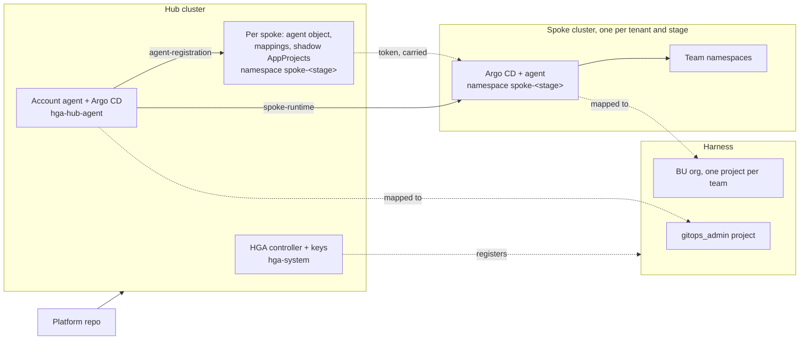

# Harness GitOps Agents reference architecture

A reference architecture for running Harness GitOps Agents at scale with the
official HGA controller (`harness/gitops-agent-bootstrap-controller`). The
headline: **onboarding a business unit is one values file.**

A hub cluster holds the controller and every Harness key. Each spoke cluster
runs its own Argo CD and GitOps agent for one tenant (a business unit, one
Harness org) and stage; each team is one Harness project, mapped to one AppProject on
the spoke. The hub registers the spoke agents and keeps them reconciled;
developers create Applications on their team's project, and the workloads land
only in the namespaces the business unit lists.



## How it works

1. **Bootstrap the hub.** The Harness pipeline `hga_hub_bootstrap` installs two
   Helm charts with Native Helm: the HGA controller into `hga-system`, then the
   ACCOUNT-scoped agent into `hga-hub-agent` (`charts/gitops-agent`), which
   also creates the API-key Secrets in `hga-system` (the hub's own and one per
   business unit), the bundled Argo CD, the repo credential, the hub cluster
   Secret and the root ApplicationSet, which syncs `bootstrap/` flat.
2. **Point it at an environment.** The Harness Environment chosen when the
   pipeline runs is stamped on the hub cluster Secret:

   | Key | Kind | Value |
   |---|---|---|
   | `fleet_member` | label | `hub-cluster` |
   | `environment` | label | Harness environment identifier |
   | `harness_env_ref` | label | same identifier; becomes `harness.io/envRef` on Applications |
   | `repo_url` | annotation | this repo |
   | `harness_account_id` | annotation | account id, injected into every spoke agent |

3. **Register a spoke.** A cluster Secret for the spoke in `hga-hub-agent`,
   labelled `fleet_member: spoke`, `tenant: <tenant>` and `stage: <stage>`.
   Its name (`spoke-<stage>`) becomes the agent's name,
   identifier (`spoke_<stage>`) and namespace on both clusters, so never rename
   it. Locally, `local/k3d.sh register` writes these Secrets.
4. **Two ApplicationSets do the rest**, both reading
   `tenants/<tenant>/<stage>/spokes.yaml` for each labelled spoke:
   - `bootstrap/agent-registration.yaml` makes `spoke-<stage>-registration` on
     the hub, namespace `spoke-<stage>` (`charts/agent-registration`): the
     ORG-scoped agent object using the business unit's key, one project
     mapping per team and deny-all shadow AppProjects. The controller
     registers the agent and writes its token there.
   - `bootstrap/spoke-runtime.yaml` (ApplicationSet `spoke-runtime`) makes
     `spoke-<stage>-runtime` on the spoke, namespace `spoke-<stage>`: a cluster-wide Argo CD and the agent
     (`charts/gitops-agent` with the agent object off), plus the team
     namespaces and the real AppProjects (`charts/agent-registration` with
     `spoke: true`).
5. **Carry the token.** The agent's token Secret is copied from the hub to the
   spoke (`local/carry-token.sh <stage> spoke-<stage>-agent-token` until External
   Secrets replaces it). The agent then connects on its own.

One hub per environment. The hub agent's identity is derived from the
environment identifier (`hga_<env>_hub`), so environment identifiers must be
lowercase letters and digits only.

## Layout

```
harness-gitops/
├── charts/        harness-gitops-agent-controller, gitops-agent,
│                  agent-registration, org-platform (parked)
├── hub/           day-0 values: controller.yaml, account-agent.yaml
├── bootstrap/     agent-registration.yaml, spoke-runtime.yaml
│                  (read flat by the root Application)
├── tenants/<tenant>/<stage>/spokes.yaml   one tenant's teams on its spokes
├── workshop/1-harness-setup/   OpenTofu for every Harness entity, including
│                               business units, their projects and keys
└── examples/org/  the parked org-shard pattern
```

Both official charts are vendored copies of the published releases
(github.com/harness/gitops-helm/releases): `harness-gitops-agent-controller`
0.1.0 verbatim, and `gitops-helm` 1.2.12 as the released tarball inside
`charts/gitops-agent`. That chart adds four optional hub templates on top
(API-key Secrets, repo credential, hub cluster Secret, root ApplicationSet),
turns the Harness plugin sidecar off, and nests every gitops-helm value under
`gitopsAgent:`. `agent-registration` and `org-platform` are ours. Switching to
Harness's remote chart repository is planned once its index lists these
versions.

Only files under `hub/` may use Harness expressions. Files under `tenants/`
are plain Helm values, because Argo CD cannot resolve them.

## Prerequisites

- A Kubernetes cluster with a Harness delegate running in it.
- Kubernetes connector `hga_test_hub`, set to inherit credentials from the
  delegate.
- Secrets `HGA-Token`, the hub's API key (account scope; the controller uses
  it for the hub agent), `hga_controller_<bu>_token` per business unit (an
  org-scoped key for that BU's spoke agents), and
  `hga_github_app`, a single-line JSON with string ids and a base64 private key:
  `{"githubAppID":"...","githubAppInstallationID":"...","githubAppPrivateKeyB64":"..."}`
- The GitHub App installed on this repo.
- Connector `hga_github` (GitHub App, on the org that holds this repo). No
  registry connector is needed: the controller image is public.
- The entities under `workshop/1-harness-setup/harness/` created in the project (org
  `gitops_reference`, project `gitops_admin`).

`workshop/1-harness-setup/` creates all of the above except the
cluster and its delegate, with one `tofu apply`.

## Bootstrap a hub

Run `hga_hub_bootstrap` with input set `hga_hub_bootstrap_test`, which fills
in:

- environment `test`, and both infrastructures (`hga_system`, `account_agent`);
- `image_tag`: a `harness/gitops-agent-bootstrap-controller` tag (`v0.1.0`);
- `deploy_agent`: `true`.

The charts and `hub/*.yaml` are fetched from branch `main`, so push first. The
verify step runs on the delegate the Kubernetes connector selects.

Verify:

- The agent `hga_test_hub` shows CONNECTED and HEALTHY in Harness.
- `kubectl -n hga-hub-agent get applications,applicationsets`

## Onboard a business unit

1. Add it to `local.business_units` in
   `workshop/1-harness-setup/business-units.tf` (org, one project per team)
   and apply. That also creates its org-scoped key, stored as
   `hga_controller_<bu>_token`.
2. Add `extra.harness-api-key-<bu>` under `apiKeySecret` in
   `hub/account-agent.yaml`, push, and run `hga_hub_bootstrap`. The key must
   be in `hga-system` before the agents can register.
3. Write `tenants/<tenant>/<stage>/spokes.yaml` per stage: `revision` (the
   upgrade group), `gitopsAgent.projectMappings` (one per team),
   `destinationNamespaces` and `sourceRepos`. Push.
4. Register each spoke's cluster Secret with the labels above (`tenant` is
   the business unit's identifier). Then carry each
   agent's token to its spoke.

Verify: `kubectl -n hga-hub-agent get applications` shows
`spoke-<stage>-registration` and `spoke-<stage>-runtime` Synced and Healthy,
and the agent `spoke_<stage>` shows CONNECTED and HEALTHY under the BU's org in
Harness, with every mapping Ready.

Developers create Applications on their team's project, in their team's
AppProject and one of the listed namespaces.

## The fences on a spoke

- The spoke's Argo CD is cluster-wide, so the team AppProjects are the fence:
  each allows `sourceRepos` into `destinationNamespaces` on the spoke only,
  no cluster-scoped objects, and no `gitops.harness.io` objects. `default` is
  locked to deny everything.
- `charts/agent-registration` refuses `kube-*`, `default` and the Argo CD
  namespace as destinations, and creates the listed namespaces itself (never
  pruned).
- No key ever reaches a spoke: the controller and every key stay on the hub,
  and the spoke agent connects with its own token.
- The agent object and its mappings carry `Delete=false`: deleting one runs
  the controller finalizer, which deregisters the agent in Harness. Offboarding
  is a deliberate manual delete.

What remains: all of a business unit's teams share its namespaces on a spoke
(per-team confinement is not built), and the token carry is manual.

## Parked: org shards on the hub

The first pattern, a namespaced Argo CD and ORG agent per org on the hub
itself (`charts/org-platform`, `examples/org/`), still renders but is not the
path forward. `org-platform` also has a parked push mode
(`remoteCluster: true`) for a hub instance deploying to a spoke.

## Things that bite

- Harness expressions in comments under `hub/` are evaluated. Never write
  expression syntax in a comment there.
- Only the controller uses the API keys, from Secrets in `hga-system`
  (`harness-api-key-secret` for the hub agent, `harness-api-key-<bu>` per
  business unit). Agents never see them: each connects to Harness with its own
  token, which the controller writes beside the agent object. Rotating a key
  means re-running the pipeline.
- A spoke agent's identity comes from its cluster Secret name and is
  immutable: renaming the Secret means a new agent.
- The official `appProject` template needs the AppProject CRD before it
  renders, so the hub creates `default` through `rootAppSet.createProject`
  (a hook) instead.
- `gitopsAgent.harnessAgent.spec.tokenSecretRef` must equal
  `gitopsAgent.agent.existingSecrets.agentToken`, or the chart refuses to render.
- `sourceRepos` left empty means deny all: nothing syncs until it is set.
- A second controller on one cluster collides on cluster-scoped CRDs. Spokes
  run no controller.
- A spoke file's `revision: HEAD` follows `main`; pin a commit or tag per
  upgrade group, nonprod first.
- An ApplicationSet that matches nothing still reports success. Check
  `kubectl get applications`, not ApplicationSet status.
- Update the vendored charts from the release assets (gitops-agent: see its
  README).

## Not included yet

- External Secrets for the agent token (carried by a local script today).
- Per-team namespace confinement on a spoke.
- Progressive rollout across upgrade groups (the hub does not enable
  progressive syncs).
- Terraform/EKS, the `application-sets` chart with addons and monitoring,
  Harness SMP, the Harness Argo plugin and controller metrics.
