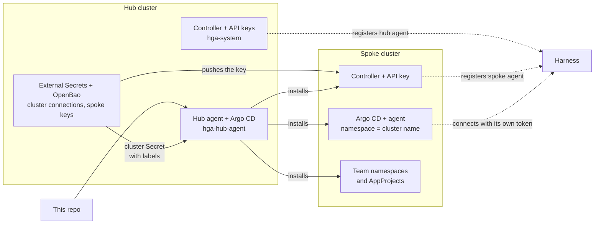

# Harness GitOps Agents reference architecture

A reference architecture for running Harness GitOps Agents on many clusters
with the official HGA controller (`harness/gitops-agent-bootstrap-controller`),
modelled on EKS Fleet Management.

One account-level agent on a **hub** cluster deploys an agent onto every
**spoke** cluster, from files in this repo. Adding a cluster is one member
file. Adding a team is one team file.

Start with the **[local workshop](workshop/README.md)** to set up a test
Harness project, bootstrap a k3d hub, and verify a spoke. For resource flow,
ownership and validation history, see the [architecture](docs/architecture.md).

## Status

Previous workshop runs used one local k3d hub and one spoke, `spoke-test`.
The grouped bootstrap has been rendered locally with Helm. Live validation is pending.
The controller and a Harness API key are on the hub and on every spoke. Each
spoke has its own key, which the hub pushes to it. This ran on `spoke-test`
in the earlier workshop.



## Layout

```
bootstrap/          group installer ApplicationSet, applied by the hub's root Application
groups/             addons, fleet registration, and spoke agent group values
fleet-members/      one file per spoke: tenant, stage, gitopsAgent,
                    harnessSecretName
decommissioned/     member files of removed spokes; nothing reads it
tenants/<tenant>/gitops-agents/
  defaults/         values for every spoke of the tenant
  defaults/teams/   one file per team, for every spoke of the tenant
  <stage>/          values, and optionally teams, for one stage
charts/             application-sets, the official controller chart, gitops-agent
                    (wraps the official gitops-helm), cluster-registration,
                    agent-registration, teams-bootstrap
hub/                values for the Day 0 pipeline
addons/hub/         values for the hub's add-ons (OpenBao)
workshop/README.md         local workshop and verification
workshop/1-harness-setup/   OpenTofu for shared Harness entities and the pipeline
workshop/2-clusters/        OpenTofu and k3d.sh for the local test clusters
docs/               the architecture document, an older page on people and
                    ownership, diagrams
```

Harness resolves its expressions in the pipeline definitions and values under
`hub/`. Keep Harness expressions out of the files Argo CD renders.

The `fleet` group uses `cluster-registration` to set up the Argo CD connection
to each spoke on the hub. The `agents` group uses `agent-registration` to
render the spoke's `HarnessGitopsAgent` and related resources, and `gitops-agent`
to run Argo CD and the agent on the spoke.

## From zero to a hub

Follow the [workshop guide](workshop/README.md) for prerequisites, commands,
and verification. The first OpenTofu stage creates the Harness
entities. The second creates the local hub and installs its delegate. The
`hga_hub_bootstrap` pipeline installs the controller, hub agent and Argo CD.
For the grouped bootstrap, use the `workshop-appsets-groups` branch as the
pipeline's `git_ref`.

## Add a cluster with an agent

1. Write two entries into the store: the cluster's connection at
   `clusters/<cluster>` (keys `server`, `caData`, `token`) and the spoke's own
   Harness API key at `harness-api-keys/<cluster>` (property `api_key`). For a
   local k3d spoke, [workshop/2-clusters/](workshop/2-clusters/README.md)
   creates the cluster and the key and writes both entries.
2. Commit `fleet-members/<cluster>.yaml` on the branch selected by `git_ref`:

   ```yaml
   tenant: bu1        # the Harness org
   stage: test        # which values and teams it gets
   gitopsAgent: true  # install an agent
   harnessSecretName: harness-api-keys/<cluster>   # the key the hub pushes
   ```

External Secrets builds the Argo CD cluster Secret from the store and the
file. Its labels make three Applications for the spoke: `<cluster>-controller`,
`<cluster>-runtime` and `<cluster>-teams`. External Secrets pushes the key to
the spoke, the spoke's controller registers the agent under the tenant's org,
and the agent connects. Every Application of a cluster carries the label
`cluster`, so the filter `cluster:<name>` in the Harness GitOps list shows
them together.

Without `harnessSecretName`, create Secret `harness-api-key-secret` in
namespace `hga-system` on the spoke by hand.

## Add a team

1. Create the team's Harness project in the tenant's org (OpenTofu,
   `workshop/1-harness-setup/business-units.tf`).
2. Commit `tenants/<tenant>/gitops-agents/defaults/teams/<team>/values.yaml`
   with the project id, the source repos, the namespaces and the destinations.
   `tenants/bu1/gitops-agents/defaults/teams/team-a/values.yaml` is an example.

Every spoke of that tenant gets the team's namespaces, its AppProject and its
mapping to the Harness project. A team file under `<stage>/teams/` reaches
only the spokes of that stage. Namespaces must start with `<team>-`.

## Things that bite

- A spoke's name is its member file name. It becomes the namespace, the agent
  name and the Harness identifier, and can never change. Neither can its
  tenant.
- Nothing is deleted automatically. Removing a member file or a team file
  leaves everything in place. Offboarding is manual.
- Move a removed spoke's member file to `decommissioned/`. A subfolder of
  `fleet-members/` is still read.
- Never delete the ExternalSecret of a live spoke: it owns the cluster Secret,
  and with it the hub's access to the spoke.
- No old `<cluster>-agent-token` Secret may exist where a controller is about
  to register an agent. The controller never overwrites one.
- OpenBao runs in dev mode and is empty after every restart. Restore the
  cluster connections and keys using the
  [restart instructions](workshop/2-clusters/README.md#after-a-hub-restart).
- An ApplicationSet that matches nothing still reports success. Check
  `kubectl --context k3d-hga-hub -n hga-hub-agent get applications`.
- Harness expressions in comments under `hub/` are evaluated. Never write
  expression syntax in a comment there.
- The hub holds cluster-admin on every spoke.
- The workshop uses one `git_ref` for its own charts and values, defaulting to
  `main` for every stage. The upstream charts are pinned to ESO `2.15.0` and
  OpenBao `0.30.7`.

## Not included yet

- A persistent secret store.
- Staged upgrades across stages.
- Offboarding a team, a spoke or a tenant.
- Team repositories feeding Applications, and Harness roles for team users.
- Anything outside local k3d clusters.
