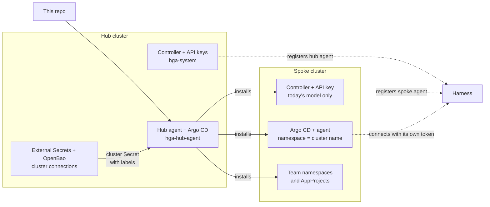

# Harness GitOps Agents reference architecture

A reference architecture for running Harness GitOps Agents on many clusters
with the official HGA controller (`harness/gitops-agent-bootstrap-controller`),
modelled on EKS Fleet Management.

One account-level agent on a **hub** cluster deploys an agent onto every
**spoke** cluster, from files in this repo. Adding a cluster is one member
file. Adding a team is one team file.

**[docs/architecture.md](docs/architecture.md) is the full description**: who
holds what, every step from an empty machine, what has run and what has not,
and the open questions. This README is the short version.

## Status

Everything here has run only on three local k3d clusters (one hub, two
spokes). Two models exist for a spoke's agent:

| Model | Member file | Where the controller and the Harness API key are | State |
|---|---|---|---|
| Today's model (v1) | `agentModel: ""` | On the hub and on every spoke. The spoke's key Secret is created by hand. | Running on both spokes |
| Hub model | `agentModel: hub` | On the hub only. External Secrets pushes the agent's own token to the spoke. | Built, never run |

The hub model is the intended one: Harness API access belongs to the hub, and
a spoke only does GitOps.



## Layout

```
bootstrap/          applied by the hub's root Application: ESO, OpenBao,
                    cluster registration, agent registration (hub model), spokes
spoke-bootstrap/    ApplicationSets that install on spokes: controller (v1 only),
                    runtime, teams
fleet-members/      one file per spoke: tenant, stage, gitopsAgent, agentModel
tenants/<tenant>/gitops-agents/
                    defaults, per-stage values, and one file per team
charts/             the official controller chart, gitops-agent (wraps the
                    official gitops-helm), cluster-registration,
                    fleet-member-registration, teams-bootstrap
hub/                values for the Day 0 pipeline
addons/hub/         values for the hub's add-ons
workshop/1-harness-setup/   OpenTofu for every Harness entity, and the pipeline
docs/               the architecture document
```

Only files under `hub/` may use Harness expressions. Everything else is
rendered by Argo CD, which cannot resolve them.

## From zero to a hub

1. Create the Harness entities: `tofu apply` in
   [workshop/1-harness-setup/](workshop/1-harness-setup/README.md). It needs a
   Harness account, a personal access token and a GitHub App installed on
   this repo.
2. Have a cluster for the hub with a Harness delegate in it. The OpenTofu
   module prints the install command.
3. Push this repo to `main`. The pipeline fetches charts and values from there.
4. Run pipeline `hga_hub_bootstrap` with input set `hga_hub_bootstrap_test`.
   It installs the controller into `hga-system`, then the hub agent with its
   Argo CD into `hga-hub-agent`.
5. The hub's Argo CD then applies `bootstrap/` by itself: External Secrets
   Operator, OpenBao with its store, and the ApplicationSets that register
   and bootstrap spokes.

Check:

```bash
kubectl -n hga-hub-agent get applications,applicationsets
```

The hub agent shows CONNECTED and HEALTHY in Harness.

## Add a cluster with an agent

Today's model:

1. Write the cluster's connection into the store at `clusters/<cluster>`
   (keys `server`, `caData`, `token`). On the test setup `local/k3d.sh
   register` does this, but only for the two test spokes (`spoke-nonprod`,
   `spoke-prod`).
2. By hand, on the spoke: create namespace `hga-system` and Secret
   `harness-api-key-secret` from the tenant's API key.
3. Commit `fleet-members/<cluster>.yaml`:

   ```yaml
   tenant: bu1        # the Harness org
   stage: nonprod     # which values and teams it gets
   gitopsAgent: true  # install an agent
   agentModel: ""     # "" = controller on the spoke, hub = hub model
   ```

External Secrets builds the Argo CD cluster Secret from the store and the
file. Its labels make three Applications for the spoke: `<cluster>-controller`,
`<cluster>-runtime` and `<cluster>-teams`. The spoke's controller registers
the agent under the tenant's org, and the agent connects.

With `agentModel: hub`, step 2 disappears. See the architecture document for
what that model installs where, and for what is not proven.

## Add a team

1. Create the team's Harness project in the tenant's org (OpenTofu,
   `workshop/1-harness-setup/business-units.tf`).
2. Commit `tenants/<tenant>/gitops-agents/<stage>/teams/<team>/values.yaml`
   with the project id, the source repos, the namespaces and the destinations.
   `tenants/bu1/gitops-agents/nonprod/teams/team-a/values.yaml` is an example.

Every spoke of that tenant and stage gets the team's namespaces, its
AppProject and its mapping to the Harness project. Namespaces must start with
`<team>-`.

## Things that bite

- A spoke's name is its member file name. It becomes the namespace, the agent
  name and the Harness identifier, and can never change. Neither can its
  tenant.
- Nothing is deleted automatically. Removing a member file or a team file
  leaves everything in place. Offboarding is manual.
- Never delete the ExternalSecret of a live spoke: it owns the cluster Secret,
  and with it the hub's access to the spoke.
- No old `<cluster>-agent-token` Secret may exist where a controller is about
  to register an agent. The controller never overwrites one.
- OpenBao runs in dev mode and is empty after every restart. Write the cluster
  connections again (`local/k3d.sh register`).
- An ApplicationSet that matches nothing still reports success. Check
  `kubectl get applications`.
- Harness expressions in comments under `hub/` are evaluated. Never write
  expression syntax in a comment there.
- The hub holds cluster-admin on every spoke.
- This repo's own charts and values follow `HEAD` of `main`; nothing is pinned
  per stage. Only the two upstream charts are pinned (ESO `2.15.0`, OpenBao
  `0.30.7`).

## Not included yet

- The hub model running on a cluster, and moving a spoke to it.
- A persistent secret store.
- Staged upgrades across stages.
- Offboarding a team, a spoke or a tenant.
- Team repositories feeding Applications, and Harness roles for team users.
- Anything outside local k3d clusters.
