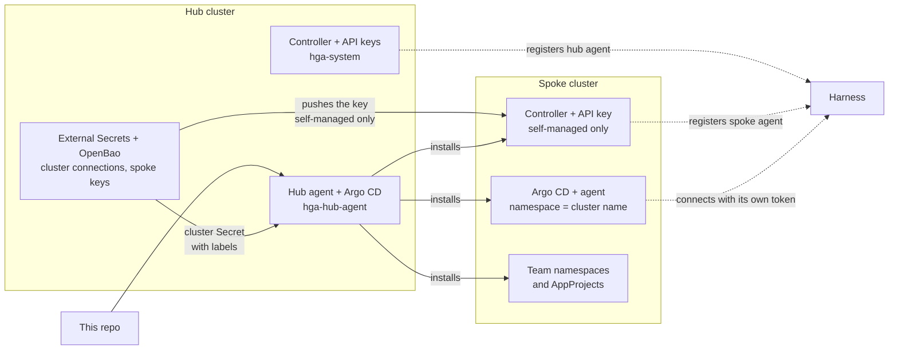

# Harness GitOps Agents reference architecture

One account-level agent on a **hub** cluster deploys an agent onto every
**spoke** cluster, from files in this repo. Adding a cluster is one member
file. Adding a team is one team file.

Start with the **[local workshop](workshop/README.md)** to set up a test
Harness project, bootstrap a k3d hub, and verify a spoke. For resource flow,
ownership and validation history, see the [architecture](docs/architecture.md).

## Status

Previous workshop runs used one local k3d hub and one spoke, `spoke-test`.
The grouped bootstrap has been rendered locally with Helm. Live validation is pending.
Two models exist for a spoke's agent:

| Model | Member file | Where the controller and the Harness API key are | State |
|---|---|---|---|
| Self-managed | `controller: self` | On the hub and on every spoke. Each spoke has its own key, which the hub pushes to it. | Ran on `spoke-test` in the earlier workshop |
| Hub-managed | `controller: hub` (the default) | On the hub only. External Secrets pushes the agent's own token to the spoke. | No fleet member uses it. It ran on one spoke that has been removed. |

Hub-managed is the intended one: Harness API access belongs to the hub, and
a spoke only does GitOps.



## Layout

```
groups/             addons, fleet registration, and spoke agent group values
fleet-members/      one file per spoke: tenant, environment, model, controller,
                    harnessSecretName
decommissioned/     member files of removed spokes; nothing reads it
tenants/<tenant>/gitops-agents/
  defaults/         values for every spoke of the tenant
  defaults/teams/   one file per team, for every spoke of the tenant
  <environment>/    values, and optionally teams, for one environment
charts/             application-sets, the official controller chart, gitops-agent
                    (wraps the official gitops-helm), cluster-registration,
                    agent-registration, teams-bootstrap
hub/                static values for the hub's day-0 install
addons/defaults/    values for the add-ons (OpenBao); addons/clusters/<cluster>/ per cluster
workshop/README.md         local workshop and verification
workshop/1-harness-setup/   OpenTofu for the shared Harness entities
workshop/2-clusters/        OpenTofu and k3d.sh: the local test clusters and the hub install
docs/               the architecture document, an older page on people and
                    ownership, diagrams
```

The files under `hub/` hold only static values. OpenTofu adds the per-hub
inputs and the keys when it installs the hub (`workshop/2-clusters/hub.tf`).

The `fleet` group uses `cluster-registration` to set up the Argo CD connection
to each spoke on the hub. The `agents` group uses `agent-registration` to
render the spoke's `HarnessGitopsAgent` and related resources, and `gitops-agent`
to run Argo CD and the agent on the spoke.

## From zero to a hub

Follow the [workshop guide](workshop/README.md) for prerequisites, commands,
and verification. The first OpenTofu stage creates the Harness
entities. The second creates the local hub and installs the controller, the
hub agent and Argo CD on it; Argo CD then bootstraps the groups. The hub
follows the branch named by `revision` in
`workshop/2-clusters/cluster-values/hub.yaml`.

## Add a cluster with an agent

Self-managed:

1. Write two entries into the store: the cluster's connection at
   `clusters/<cluster>` (keys `server`, `caData`, `token`) and the spoke's own
   Harness API key at `harness-api-keys/<cluster>` (property `api_key`). For a
   local k3d spoke, [workshop/2-clusters/](workshop/2-clusters/README.md)
   creates the cluster and the key and writes both entries.
2. Commit `fleet-members/<cluster>.yaml` on the branch the hub follows:

   ```yaml
   tenant: bu1        # the Harness org
   environment: test  # which values and teams it gets
   model: agent       # install an agent (push: registered only)
   addons: hub        # the hub pushes this cluster's add-ons
   controller: self   # self = self-managed, hub = hub-managed
   harnessSecretName: harness-api-keys/<cluster>   # the key the hub pushes
   ```

External Secrets builds the Argo CD cluster Secret from the store and the
file. Its labels make three Applications for the spoke: `<cluster>-controller`,
`<cluster>-runtime` and `<cluster>-teams`. External Secrets pushes the key to
the spoke, the spoke's controller registers the agent under the tenant's org,
and the agent connects. Every Application of a cluster carries the label
`cluster`, so the filter `cluster:<name>` in the Harness GitOps list shows
them together.

Without `harnessSecretName`, create Secret `harness-api-key-secret` in
namespace `hga-system` on the spoke by hand.

With `controller: hub`, leave `harnessSecretName` out: no key and no
controller go to the spoke. See the architecture document for what that model
installs where, and for what is not proven.

## Add a team

1. Create the team's Harness project in the tenant's org (OpenTofu,
   `workshop/1-harness-setup/business-units.tf`).
2. Commit `tenants/<tenant>/gitops-agents/defaults/teams/<team>/values.yaml`
   with the project id, the source repos, the namespaces and the destinations.
   `tenants/bu1/gitops-agents/defaults/teams/team-a/values.yaml` is an example.

Every spoke of that tenant gets the team's namespaces, its AppProject and its
mapping to the Harness project. A team file under `<environment>/teams/`
reaches only the spokes of that environment. Namespaces must start with
`<team>-`.

## Things that bite

- A spoke's name is its member file name. It becomes the namespace, the agent
  name and the Harness identifier, and can never change. Neither can its
  tenant.
- Nothing is deleted automatically. Removing a member file or a team file
  leaves everything in place. Offboarding is manual.
- Move a removed spoke's member file to `decommissioned/`. A subfolder of
  `fleet-members/` is still read.
- Never delete the ExternalSecret of a live spoke: it owns the cluster Secret,
  and with it the hub's access to the spoke.
- No old `<cluster>-agent-token` Secret may exist where a controller is about
  to register an agent. The controller never overwrites one.
- OpenBao runs in dev mode and is empty after every restart. Restore the
  cluster connections and keys using the
  [restart instructions](workshop/2-clusters/README.md#after-a-hub-restart).
- An ApplicationSet that matches nothing still reports success. Check
  `kubectl --context k3d-hga-hub -n hga-hub-agent get applications`.
- The hub holds cluster-admin on every spoke.
- The hub follows one branch for the group files, its own charts and their
  values (`revision`, default `main`). The upstream charts are pinned to ESO `2.15.0` and
  OpenBao `0.30.7`.

## Not included yet

- Hub-managed on a current fleet member, and moving a spoke to it.
- A persistent secret store.
- Staged upgrades across environments.
- Offboarding a team, a spoke or a tenant.
- Team repositories feeding Applications, and Harness roles for team users.
- Anything outside local k3d clusters.
