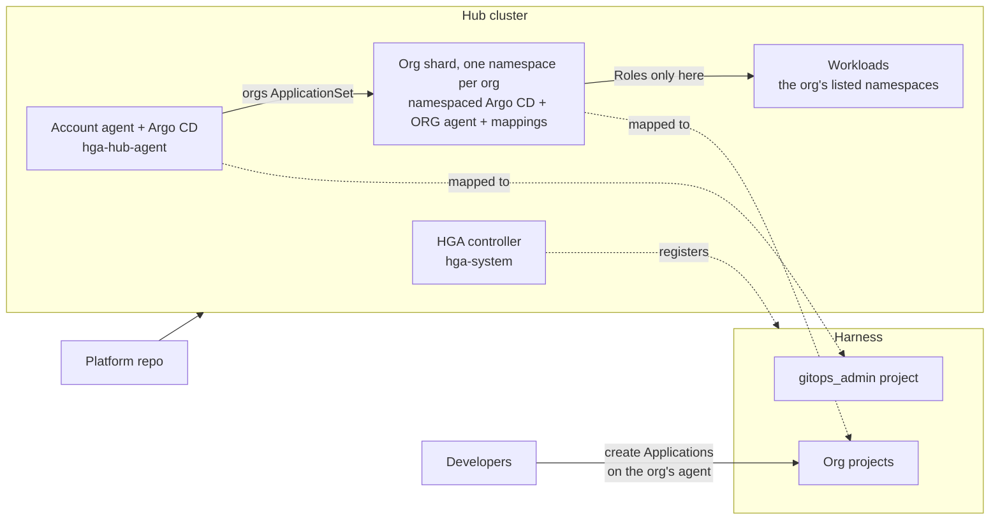

# Harness GitOps Agents reference architecture

A reference architecture for running Harness GitOps Agents at scale with the
HGA controller. The headline: **onboarding an org is one pull request.**

The platform team adds one values file per Harness org. The hub turns it into
an org shard: a namespace holding a dedicated, namespaced Argo CD with an
ORG-scoped agent and one project mapping per Harness project, plus the org's
workload namespaces and the walls around them. Developers then create
Applications on their org's agent, and the workloads land only in the
namespaces the org file lists.



## How it works

1. **Bootstrap the hub.** The Harness pipeline `hga_hub_bootstrap` installs two
   Helm charts with Native Helm: the HGA controller into `hga-system`, then the
   ACCOUNT-scoped agent into `hga-hub-agent`. The agent chart also creates the
   bundled Argo CD, the repo credential, the hub cluster Secret and the root
   ApplicationSet, which syncs `bootstrap/` flat.
2. **Point it at an environment.** The Harness Environment chosen when the
   pipeline runs is stamped on the hub cluster Secret. That Secret is the only
   per-hub input:

   | Key | Kind | Value |
   |---|---|---|
   | `fleet_member` | label | `hub-cluster` (what every ApplicationSet selects) |
   | `environment` | label | Harness environment identifier; picks `environments/<env>/` |
   | `harness_env_ref` | label | same identifier; becomes `harness.io/envRef` on Applications |
   | `repo_url` | annotation | this repo |
   | `harness_account_id` | annotation | account id, injected into every org agent |

3. **Add an org file.** `bootstrap/orgs.yaml` pairs the hub cluster with
   `environments/<env>/orgs/<name>/values.yaml`. Each file becomes one
   Application, `org-<name>`, with two Helm sources fed the same file:
   `charts/harness-gitops-agent-bootstrap` (a namespaced Argo CD with no
   ClusterRoles, the ORG agent, the project mappings) and
   `charts/org-platform` (the workload namespaces, Roles in them, a restricted
   cluster entry and the AppProjects). `<name>` is the namespace of the org's
   Argo CD, the Helm release and the Application suffix.

One hub per environment. Agent identity is derived from the environment
identifier (`hga_<env>_hub`), so environment identifiers must be lowercase
letters and digits only: they are also a label value, a folder name and part of
a DNS name.

## Layout

```
harness-gitops/
├── charts/        controller and bootstrap (vendored), org-platform (the walls)
├── harness/       pipeline, 2 services, environment, 2 infrastructures
├── hub/           day-0 values: controller.yaml, account-agent.yaml
├── bootstrap/     orgs.yaml (read flat by the root Application)
├── environments/<env>/orgs/<name>/values.yaml
└── examples/org/   values.yaml (template for one org file) and
                    sample-application.yaml (what a developer creates)
```

Only files under `hub/` may use Harness expressions. Files under
`environments/` are plain Helm values, because Argo CD cannot resolve them.

## Prerequisites

- A Kubernetes cluster with a Harness delegate running in it.
- Kubernetes connector `hga_test_hub`, set to inherit credentials from the
  delegate.
- Secrets `hga_api_key` (an account-scope key that can create agents) and
  `hga_github_app`, a single-line JSON with string ids and a base64 private key:
  `{"githubAppID":"...","githubAppInstallationID":"...","githubAppPrivateKeyB64":"..."}`
- The GitHub App installed on this repo.
- Connectors `account.generic` (GitHub) and `account.DockerHub`.
- The entities under `harness/` created in the project (org
  `gitops_reference`, project `gitops_admin`).

## Bootstrap a hub

Run `hga_hub_bootstrap` with:

- environment `test`, and both infrastructures (`hga_system`, `account_agent`);
- `git_ref`: the commit to deploy, from `git rev-parse HEAD`. It must be pushed;
- `image_tag`: the controller image tag on Docker Hub;
- `delegate_selector`: the tag of the delegate inside the cluster.

Verify:

- The agent `hga_test_hub` shows CONNECTED and HEALTHY in Harness.
- `kubectl -n hga-hub-agent get applications,applicationsets`

## Add an org

1. Copy `examples/org/values.yaml` to `environments/<env>/orgs/<name>/` and
   replace every `REPLACE_` placeholder. `<name>` must be a DNS label. List the
   org's `workloadNamespaces` (each must start with `<name>-`) and the
   `sourceRepos` it may deploy from.
2. Add `<name>` to `manager.managedNamespaces` in `hub/controller.yaml`, then
   re-run the pipeline.
3. Create Secret `harness-api-key-secret` with key `api_key` in namespace
   `<name>`. An org-scoped key is enough.
4. Commit and push. Verify with `kubectl -n hga-hub-agent get applications`
   (a new `org-<name>` appears) and `kubectl -n <name> get appprojects`.

Developers then create Applications on the org's agent, like
`examples/org/sample-application.yaml`. A private source repo needs an Argo CD
repository credential Secret in namespace `<name>`.

## The walls, and what they do not cover

`charts/org-platform` builds three layers around each org:

1. **Kubernetes Roles.** The org's Argo CD has no ClusterRoles. The platform
   grants Roles only in the listed workload namespaces: full control for
   `argocd-application-controller`, `pods/log` for `gitops-agent` (Harness
   reads logs through the agent). Nothing else is reachable, whatever Argo CD
   is told. The platform creates the namespaces, so no `CreateNamespace`.
2. **A restricted cluster entry.** The org's only destination, `hub-cluster`,
   is limited to the listed namespaces with cluster resources off. The
   implicit in-cluster destination is disabled.
3. **AppProjects.** One per project mapping, allowing `sourceRepos` into the
   listed namespaces and no cluster-scoped objects. `default` is locked to
   deny everything, since Argo CD creates a wide-open one in every instance.

What remains:

- All of an org's projects share the org's namespaces. Per-project
  confinement is not built.
- An org may only list namespaces that start with its own name, so it cannot
  claim `kube-system` or another org's namespaces. The one gap: do not give an
  org a name that is another org's name plus a dash-suffix (`bu` and
  `bu-payments`), because the shorter one's prefix covers the longer one.
- Removing a namespace from the list, or deleting an org file, leaves its
  Namespace and Roles in place: the hub does not prune.

## Things that bite

- Harness expressions in comments under `hub/` are evaluated. Never write
  expression syntax in a comment there.
- A namespace missing from `manager.managedNamespaces` makes the agent report
  `NamespaceNotAllowed`.
- Argo CD does not create `harness-api-key-secret`; each org needs it before
  its agent can register.
- Never rename an org folder. The folder name is the Helm release name, which
  is baked into immutable Deployment selectors.
- `tokenSecretRef` must equal `gitopsAgent.agent.existingSecrets.agentToken`, or
  the chart refuses to render.
- `org-platform` refuses to render without `workloadNamespaces`, with a
  namespace that does not start with `<name>-`, with `appProject: default`, or
  with a duplicate `appProject`.
- `sourceRepos` left empty means deny all: nothing syncs until it is set.
- A second controller on one cluster collides on cluster-scoped CRDs.
- An ApplicationSet that matches nothing still reports success. Check
  `kubectl get applications`, not ApplicationSet status.
- Update the vendored charts by re-copying, not by editing.

## Not included yet

- Handing each org a root Application over its own repo, so developers work
  only in git rather than creating Applications on the agent.
- Per-project namespace confinement within an org.
- A shared-agent variant (project mappings on an existing Argo CD, no new
  instance) is possible but not built.
- Agents on spoke clusters: the same org file landing on another cluster.
- Terraform/EKS, the `application-sets` chart with addons and monitoring,
  Harness SMP, the Harness Argo plugin and controller metrics.
